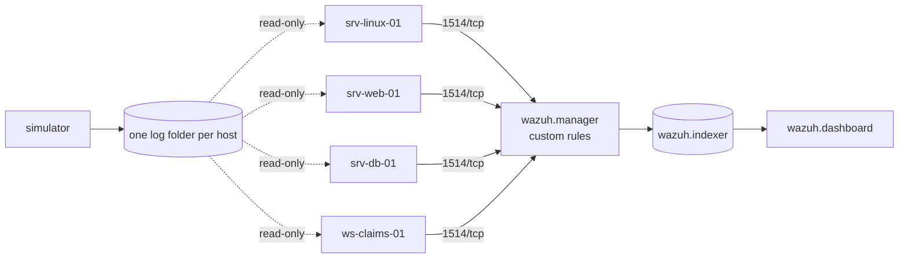

# insurance-soc-lab

[](https://github.com/arixstoo/insurance-soc-lab/actions/workflows/ci.yml)
[](https://github.com/arixstoo/insurance-soc-lab/actions/workflows/e2e.yml)


**A complete SOC lab for an insurance company, in one `docker compose up`:**
Wazuh SIEM, four monitored hosts, a telemetry simulator that attacks the company
every few minutes, and 16 custom detection rules - each one tested against the
real Wazuh engine in CI.

> **Built in and for the real world.** This project was designed and first
> deployed during my 2026 cybersecurity internship in the IT security team of a
> **major Algerian insurance company**, to answer a real need: the company had
> strong prevention (NGFW, IPS, XDR, segmentation) but no central correlation
> of security events. Under confidentiality, this public version uses a
> fictional insurer, **InsurCo**, and 100% synthetic data. No real log, name,
> address or credential from the company appears here.

## What it detects

| Threat | Rules | MITRE ATT&CK |
|---|---|---|
| SSH brute force, then a successful login from the same IP | 100100, 100101 | T1110.001, T1078 |
| Logins outside office hours from outside the network, or to privileged accounts | 100102, 100103 | T1078, T1078.003 |
| sudo to a root shell / change of credential files | 100110 | T1548.003 |
| SQL injection, XSS, path traversal, secret-file probing, coordinated campaigns | 100120-100129 | T1190, T1083, T1595.003 |
| **Insider misuse of customer data**: bulk reads of clients/claims/payments, repeated or at night (service accounts allow-listed) | 100131-100134 | T1213, T1530 |
| Windows password guessing, new accounts, users added to Administrators, **account created then made admin within 10 min** | 100142-100145 | T1110, T1136.001, T1098 |

Full catalog with false positives and coverage gaps: [docs/detection-catalog.md](docs/detection-catalog.md)
(tables generated from the XML). Noise budget: 24 h of normal activity, replayed through the
real engine, gives 3 custom alerts - [docs/tuning-report.md](docs/tuning-report.md).

## Architecture



Details and design decisions: [docs/architecture.md](docs/architecture.md).

## Quick start

Requirements: Docker with Compose v2.23+, 8 GB RAM free, Linux/WSL2/macOS.
On Linux hosts run `sudo sysctl -w vm.max_map_count=262144` once (OpenSearch).

```bash
git clone https://github.com/arixstoo/insurance-soc-lab.git && cd insurance-soc-lab
make certs                 # TLS certificates, once
make rotate                # REQUIRED: replaces the public Wazuh default passwords (writes .env)
make up                    # build, start, wait until healthy, apply 30-day alert retention
make status                # agents active, defaults rejected, custom rules fired -> OK
```

On Windows PowerShell, the same verbs: `.\scripts\lab.ps1 certs`, `.\scripts\lab.ps1 rotate`,
`.\scripts\lab.ps1 up`, `.\scripts\lab.ps1 status`. (`make up` / `lab.ps1 up` also run the
first two steps by themselves if `stack/certs/` or `.env` is missing.)

Without `make`: `docker compose -f stack/certs.compose.yml run --rm generator`,
`scripts/rotate-passwords.sh`, `docker compose up -d --build --wait`, `python scripts/apply_ism.py`.

Dashboard: <https://localhost>, user `admin`, password = `INDEXER_PASSWORD` in your `.env`.
Skipping the rotate step leaves the public upstream passwords in place; `make status` reports
it. Rotating a lab that is already running: `make rotate APPLY=1` (see [SECURITY.md](SECURITY.md)).

On a machine that already has the images, the lab is healthy in about a minute and the
first custom alert arrives within two. Background activity follows office hours
(08:00-18:00 local time, quiet nights, Friday and Saturday at ~20%); a random attack
scenario runs every 2-5 minutes, day and night. To trigger one now:

```bash
docker compose exec simulator insurco-sim list            # 6 scenarios + the rules they target
docker compose exec simulator insurco-sim inject insider  # mass customer-data access
```

Measure the lab:

```bash
docker compose exec simulator insurco-sim stats   # events per host per minute, ev/s
python scripts/measure_latency.py                 # log line -> alert -> searchable (seconds)
bash scripts/e2e.sh                               # inject every scenario, assert its rules in the indexer
```

**Real services** (optional, compose profile `real`): a real `sshd`, a real nginx and a real
PostgreSQL with `pgaudit`, each with its own agent, plus a test client that sends scripted
failed logins, malformed web requests and a bulk export to those containers only. The same
detection families fire on the simulated and the real logs; the differences are documented
in [docs/real-services.md](docs/real-services.md).

```bash
make up REAL=1      # PowerShell: .\scripts\lab.ps1 up -Real   - 3 more agents
make traffic        # PowerShell: .\scripts\lab.ps1 traffic    - lab-traffic all
```

## Test the detections

```bash
pip install pyyaml
python detection/tests/run_tests.py        # 77 cases against wazuh/wazuh-manager:4.14.9
```

```text
  PASS  ssh brute force - 6 failures from one IP  (fired 100100)
  PASS  success right after brute force = account compromise  (fired 100101)
  PASS  repeated bulk reads by one user = insider threat  (fired 100132)
  PASS  bulk read at night  (fired 100133)
  ...
77/77 passed
```

Rules with an office-hours condition are tested by starting the manager on a
clock where it is 02:00 or 12:00 - Wazuh evaluates `<time>` on the manager
clock, not on the log timestamp.

On top of that, the `e2e` workflow starts the **whole lab** on a GitHub runner (with the
real services), injects every scenario, sends the test client's traffic to the real hosts,
and checks that each expected rule reaches the indexer - from the real host's agent for the
real traffic.

## Repository layout

```text
detection/   rules (XML) + test cases + wazuh-logtest runner
simulator/   insurco-sim: synthetic telemetry and attack scenarios (Python, tested)
agents/      Wazuh agent image, config rendered from a template
stack/       Wazuh configuration (adapted from wazuh-docker, see NOTICE)
docs/        architecture, detection catalog, runbooks, production plan
scripts/     lab.ps1, password rotation, retention policy, lab status, e2e check, latency
```

## About this public version

Before publication, everything that could identify the company was removed:
the insurer's name (replaced by the fictional **InsurCo**), the names and
usernames of its employees, its real IP addresses, hostnames and credentials.
Every address in this repository comes from the lab range `10.20.0.0/16` or the
RFC 5737 documentation ranges, and every log is generated by the simulator.

What comes next: [ROADMAP.md](ROADMAP.md).

## Author

**Saidi Mohamed Rostom** - cybersecurity engineering student (USTHB), SOC & Blue Team.
[LinkedIn](https://www.linkedin.com/in/saidi-mohamed-rostom) · [GitHub](https://github.com/arixstoo)

Licensed under MIT. Wazuh configuration files: GPLv2, see [stack/NOTICE.md](stack/NOTICE.md).
