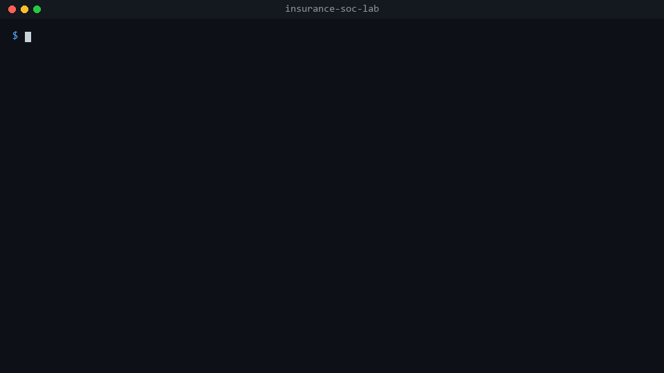
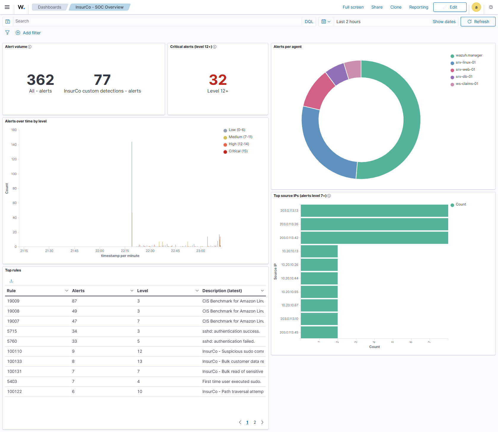
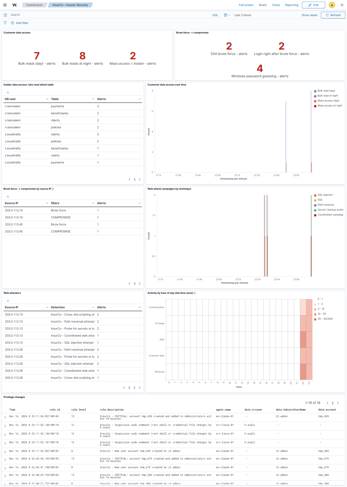
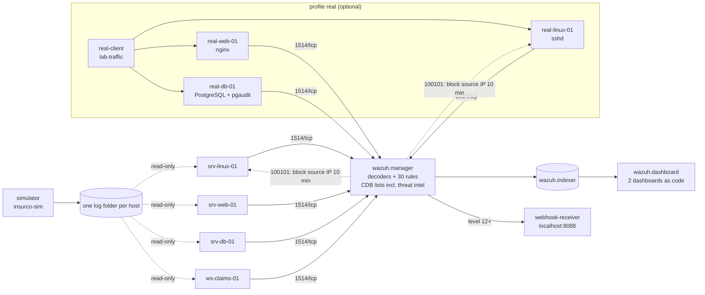

# insurance-soc-lab

[](https://github.com/arixstoo/insurance-soc-lab/actions/workflows/ci.yml)
[](https://github.com/arixstoo/insurance-soc-lab/actions/workflows/e2e.yml)
[](https://github.com/arixstoo/insurance-soc-lab/actions/workflows/security.yml)
[](https://arixstoo.github.io/insurance-soc-lab/)
[](https://documentation.wazuh.com/4.14/)
[](docs/mitre-layer.json)
[](LICENSE)

**A complete SOC lab for an insurance company, in one `make up`:** a Wazuh 4.14.9 SIEM,
four monitored hosts (plus three real services on demand), a telemetry simulator that
attacks the company every few minutes, and **30 custom detection rules** - each one tested
against the real Wazuh engine in CI (98 cases), routed to a webhook, linked to a runbook,
answered by an active response where it makes sense, and ported to **13 Sigma rules** that
are checked to agree with the Wazuh rules on the same cases.

> **Built in and for the real world.** This project was designed and first
> deployed during my 2026 cybersecurity internship in the IT security team of a
> **major Algerian insurance company**, to answer a real need: the company had
> strong prevention (NGFW, IPS, XDR, segmentation) but no central correlation
> of security events. Under confidentiality, this public version uses a
> fictional insurer, **InsurCo**, and 100% synthetic data. No real log, name,
> address or credential from the company appears here.



<sub>Recorded run: `make up` and `make status` on a lab whose images were already built, then
the two dashboards after injecting every scenario. Rendered from the transcripts by
`scripts/make_demo_gif.py`.</sub>

Documentation site: **<https://arixstoo.github.io/insurance-soc-lab/>** ·
résumé en français : [docs/README.fr.md](docs/README.fr.md)

## Quick start (about 10 minutes)

Requirements: Docker with Compose v2.23+, 8 GB of free RAM, `git`, `make`, Python 3.10+
(standard library only) - Linux, macOS or Windows with WSL2. On Linux run
`sudo sysctl -w vm.max_map_count=262144` once (OpenSearch needs it).

```bash
git clone https://github.com/arixstoo/insurance-soc-lab.git && cd insurance-soc-lab
make certs                 # TLS certificates, once
make rotate                # REQUIRED: replaces the public Wazuh default passwords (writes .env)
make up                    # build, start, wait until healthy, 30-day retention, import dashboards
make status                # agents active, defaults rejected, response chain, custom rules fired -> OK
```

The first `make up` pulls the Wazuh images and builds the lab's own (most of the
10 minutes); after that the lab is healthy in about a minute. A random attack runs every
2-5 minutes, so `make status` lists custom alerts within a few minutes. To see one now:

```bash
docker compose exec simulator insurco-sim list            # 7 scenarios + the rules they target
docker compose exec simulator insurco-sim inject insider  # mass customer-data access -> 100131, 100132
```

Dashboard: <https://localhost>, user `admin`, password = `INDEXER_PASSWORD` in your `.env`,
then menu -> Dashboards -> **InsurCo - SOC Overview** / **InsurCo - Insurer Security**.
Level 12+ alerts also appear in the lab's webhook receiver on <http://localhost:8088>.

<details>
<summary>Windows PowerShell, no <code>make</code>, rotating a running lab</summary>

- PowerShell has the same verbs: `.\scripts\lab.ps1 certs`, `rotate`, `up`, `status`.
  (`make up` / `lab.ps1 up` also run the first two steps by themselves if `stack/certs/` or
  `.env` is missing.)
- Without `make`: `docker compose -f stack/certs.compose.yml run --rm generator`,
  `scripts/rotate-passwords.sh`, `docker compose up -d --build --wait`,
  `python scripts/apply_ism.py`, `python scripts/import_dashboards.py`.
- Skipping the rotate step leaves the public upstream passwords in place; `make status`
  reports it. Rotating a lab that is already running: `make rotate APPLY=1`
  ([SECURITY.md](SECURITY.md)).
- Stop: `make down` (data kept) · wipe: `make reset`.

</details>

## What it detects

| Threat | Rules | MITRE ATT&CK |
|---|---|---|
| SSH brute force, then a successful login from the same IP | 100100, 100101 | T1110.001, T1078 |
| Logins outside office hours from outside the network, or to privileged accounts | 100102, 100103 | T1078, T1078.003 |
| sudo to a root shell / change of credential files | 100110 | T1548.003 |
| SQL injection, XSS, path traversal, secret-file probing, coordinated campaigns | 100120-100129 | T1190, T1083, T1595.003 |
| **Insider misuse of customer data**: bulk reads of clients/claims/payments, repeated or at night (service accounts allow-listed), on the simulated audit log and on real `pgaudit` | 100131-100138 | T1213, T1530 |
| Windows password guessing, new accounts, users added to Administrators, **account created then made admin within 10 min** | 100142-100145 | T1110, T1136.001, T1098 |
| **Threat intel**: login, page view (with or without a query string), night login or web campaign from a known-bad IP (public feed, cached, offline sample) | 100150-100154 | T1078, T1595, T1190 |

ATT&CK coverage as a Navigator layer generated from the rules (colour = number of rules per
technique): [docs/mitre-layer.json](docs/mitre-layer.json) -
[open it in the ATT&CK Navigator](https://mitre-attack.github.io/attack-navigator/#layerURL=https%3A%2F%2Fraw.githubusercontent.com%2Farixstoo%2Finsurance-soc-lab%2Fmain%2Fdocs%2Fmitre-layer.json).

Full catalog with false positives and coverage gaps: [docs/detection-catalog.md](docs/detection-catalog.md)
(tables generated from the XML). Noise budget: 24 h of normal activity, replayed through the
real engine, gives **3 custom alerts** - [docs/tuning-report.md](docs/tuning-report.md).

## Dashboards

Two dashboards ship as code (`dashboards/*.ndjson`, built through the saved-objects API) and
are imported by `make up`: after a reset they show data with no manual click.

| InsurCo - SOC Overview | InsurCo - Insurer Security |
|---|---|
| [](docs/img/soc-overview.png) | [](docs/img/insurer-security.png) |
| volume, critical count, timeline by level, top rules, top source IPs, alerts per agent | insider data access, brute force -> compromise, web campaigns, privilege changes, heatmap by hour |

Every `rule.id` / `rule.groups` a panel filters on is checked against the detection tests.
How they are built, imported and checked: [docs/dashboards.md](docs/dashboards.md).

## Architecture



Details and design decisions: [docs/architecture.md](docs/architecture.md).

## Response

Every rule links its **runbook** ([docs/runbooks/](docs/runbooks/README.md)); every alert of
level 12+ is **posted to a webhook** by a custom Wazuh integration, and the lab's own
`webhook-receiver` shows them offline on <http://localhost:8088>; a brute force that
succeeds (100101) **blocks the source IP on the targeted host for 10 minutes** (Wazuh active
response, lab only), then lifts the block by itself. Flow, sequence diagram and safety
limits: [docs/response.md](docs/response.md). Proof on a running lab:
`python scripts/check_response.py` (`make response`).

## Portability: Sigma

The main detections (brute force, web attacks, insider bulk read, rogue admin) also exist as
**Sigma rules** ([detection/sigma/rules/](detection/sigma/rules/)), Sigma v2 correlations
included. CI validates them with pySigma and checks that each one **agrees with its Wazuh
rule on the same engine-verified test cases**. What maps to what, the field mapping and the
limits of the translation: [detection catalog - Sigma rules](docs/detection-catalog.md#sigma-rules).

## Test the detections

```bash
pip install -r detection/requirements.txt  # pyyaml, pysigma
python detection/tests/run_tests.py        # 98 cases against wazuh/wazuh-manager:4.14.9
```

```text
  PASS  ssh brute force - 6 failures from one IP  (fired 100100)
  PASS  success right after brute force = account compromise  (fired 100101)
  PASS  repeated bulk reads by one user = insider threat  (fired 100132)
  PASS  bulk read at night  (fired 100133)
  ...
98/98 passed
```

Every rule has a case that must fire and a normal-activity case that must stay quiet. Rules
with an office-hours condition run on a manager clock set to 02:00 or 12:00 (Wazuh evaluates
`<time>` on the manager clock, not on the log timestamp), and time windows ("9 minutes vs
11 minutes") on a replay engine that moves analysisd's clock.

On top of that, the `e2e` workflow starts the **whole lab** on a GitHub runner (with the
real services), injects every scenario, sends the test client's traffic to the real hosts,
checks that each expected rule reaches the indexer, then proves the response chain: webhook
message, block, expiry.

Measure a running lab:

```bash
docker compose exec simulator insurco-sim stats   # events per host per minute, ev/s
python scripts/measure_latency.py                 # log line -> alert -> searchable (seconds)
bash scripts/e2e.sh                               # inject every scenario, assert its rules in the indexer
```

**Real services** (optional, compose profile `real`): a real `sshd`, a real nginx and a real
PostgreSQL with `pgaudit`, each with its own agent, plus a test client that sends scripted
failed logins, malformed web requests and a bulk export to those containers only. The same
detection families fire on the simulated and the real logs; the differences are documented
in [docs/real-services.md](docs/real-services.md).

```bash
make up REAL=1      # PowerShell: .\scripts\lab.ps1 up -Real   - 3 more agents
make traffic        # PowerShell: .\scripts\lab.ps1 traffic    - lab-traffic all
```

## What I learned

The lab taught me more through its failures than its features: that a detection rule is only
real once the engine has run it, that Wazuh picks sibling rules by level and lets a child
rule silently replace its parent's alert, that `<time>` follows the manager's clock and not
the log, that an e2e flake can hide a real race for two releases, and that 2101 alerts a day
can become 3 with two documented decisions. The full list, with the release that found each
point: **[docs/lessons-learned.md](docs/lessons-learned.md)**.

## Repository layout

```text
detection/   rules (XML), decoders, CDB lists, Sigma rules, test cases + wazuh-logtest runner, replay engine
simulator/   insurco-sim: synthetic telemetry and attack scenarios (Python, tested)
real/        optional real hosts (sshd, nginx, PostgreSQL + pgaudit) and the lab test client
response/    alert routing: Wazuh webhook integration + offline webhook receiver (tested)
dashboards/  SOC dashboards as saved-object exports (.ndjson), imported by make up
agents/      Wazuh agent image, config rendered from a template
stack/       Wazuh configuration (adapted from wazuh-docker, see NOTICE)
docs/        documentation site: architecture, catalog, tuning, runbooks, response, lessons learned
scripts/     lab.ps1, passwords, retention, dashboards, threat intel, lab status, e2e / response checks
```

## About this public version

Before publication, everything that could identify the company was removed:
the insurer's name (replaced by the fictional **InsurCo**), the names and
usernames of its employees, its real IP addresses, hostnames and credentials.
Every address in this repository comes from the lab range `10.20.0.0/16` or the
RFC 5737 documentation ranges, and every log is generated by the simulator.

Changes per release: [CHANGELOG.md](CHANGELOG.md) · phases and what comes next: [ROADMAP.md](ROADMAP.md).

## Author

**Saidi Mohamed Rostom** - cybersecurity engineering student (USTHB), SOC & Blue Team.
[LinkedIn](https://www.linkedin.com/in/saidi-mohamed-rostom) · [GitHub](https://github.com/arixstoo)

Licensed under MIT. Wazuh configuration files: GPLv2, see [stack/NOTICE.md](stack/NOTICE.md).
