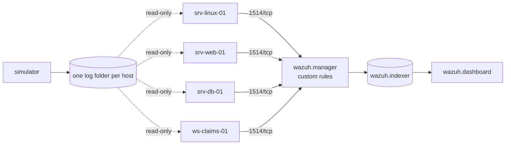

# insurance-soc-lab

[](https://github.com/arixstoo/insurance-soc-lab/actions/workflows/ci.yml)


**A complete SOC lab for an insurance company, in one `docker compose up`:**
Wazuh SIEM, four monitored hosts, a telemetry simulator that attacks the company
every few minutes, and 16 custom detection rules - each one tested against the
real Wazuh engine in CI.

> **Built in and for the real world.** This project was designed and first
> deployed during my 2026 cybersecurity internship in the IT security team of a
> **major Algerian insurance company**, to answer a real need: the company had
> strong prevention (NGFW, IPS, XDR, segmentation) but no central correlation
> of security events. Under confidentiality, this public version uses a
> fictional insurer, **InsurCo**, and 100% synthetic data. No real log, name,
> address or credential from the company appears here.

## What it detects

| Threat | Rules | MITRE ATT&CK |
|---|---|---|
| SSH brute force, then a successful login from the same IP | 100100, 100101 | T1110.001, T1078 |
| Logins outside office hours | 100102 | T1078 |
| sudo to a root shell / change of credential files | 100110 | T1548.003 |
| SQL injection, XSS, path traversal, secret-file probing, coordinated campaigns | 100120-100129 | T1190, T1083, T1595.003 |
| **Insider misuse of customer data**: bulk reads of clients/claims/payments, repeated or at night | 100131-100133 | T1213, T1530 |
| Windows password guessing, new accounts, users added to Administrators | 100141-100144 | T1110, T1136.001, T1098 |

Full catalog with false positives and coverage gaps: [docs/detection-catalog.md](docs/detection-catalog.md).

## Architecture



Details and design decisions: [docs/architecture.md](docs/architecture.md).

## Quick start

Requirements: Docker with Compose v2.23+, 8 GB RAM free, Linux/WSL2/macOS.
On Linux hosts run `sudo sysctl -w vm.max_map_count=262144` once (OpenSearch).

```bash
git clone https://github.com/arixstoo/insurance-soc-lab.git && cd insurance-soc-lab
cp .env.example .env
docker compose -f stack/certs.compose.yml run --rm generator   # TLS certificates, once
docker compose up -d --build
python scripts/lab_status.py                                   # agents + custom rules fired
```

Dashboard: <https://localhost> (lab defaults in `.env` - change them, see [SECURITY.md](SECURITY.md)).
A random attack scenario runs every 2-5 minutes. To trigger one now:

```bash
docker compose exec simulator insurco-sim list            # 6 scenarios + the rules they target
docker compose exec simulator insurco-sim inject insider  # mass customer-data access
```

## Test the detections

```bash
pip install pyyaml
python detection/tests/run_tests.py        # 24 cases against wazuh/wazuh-manager:4.14.9
```

```text
  PASS  ssh brute force - 6 failures from one IP  (fired 100100)
  PASS  success right after brute force = account compromise  (fired 100101)
  PASS  repeated bulk reads by one user = insider threat  (fired 100132)
  PASS  bulk read at night  (fired 100133)
  ...
24/24 passed
```

Rules with an office-hours condition are tested by starting the manager on a
clock where it is 02:00 or 12:00 - Wazuh evaluates `<time>` on the manager
clock, not on the log timestamp.

## Repository layout

```text
detection/   rules (XML) + test cases + wazuh-logtest runner
simulator/   insurco-sim: synthetic telemetry and attack scenarios (Python, tested)
agents/      Wazuh agent image, config rendered from a template
stack/       Wazuh configuration (adapted from wazuh-docker, see NOTICE)
docs/        architecture, detection catalog, runbooks, production plan, lessons learned
scripts/     lab status and helpers
```

## The story behind the rebuild

The internship version worked well enough for a demo - but its custom rules
never fired, and the code stayed on the company VM when the internship ended.
This repository is the rebuild: 15 root causes found and fixed, from wrong
parent rule IDs to configuration lost every time a container restarted.
Read the post-mortem: [docs/lessons-learned.md](docs/lessons-learned.md).

What comes next: [ROADMAP.md](ROADMAP.md).

## Author

**Saidi Mohamed Rostom** - cybersecurity engineering student (USTHB), SOC & Blue Team.
[LinkedIn](https://www.linkedin.com/in/saidi-mohamed-rostom) · [GitHub](https://github.com/arixstoo)

Licensed under MIT. Wazuh configuration files: GPLv2, see [stack/NOTICE.md](stack/NOTICE.md).
