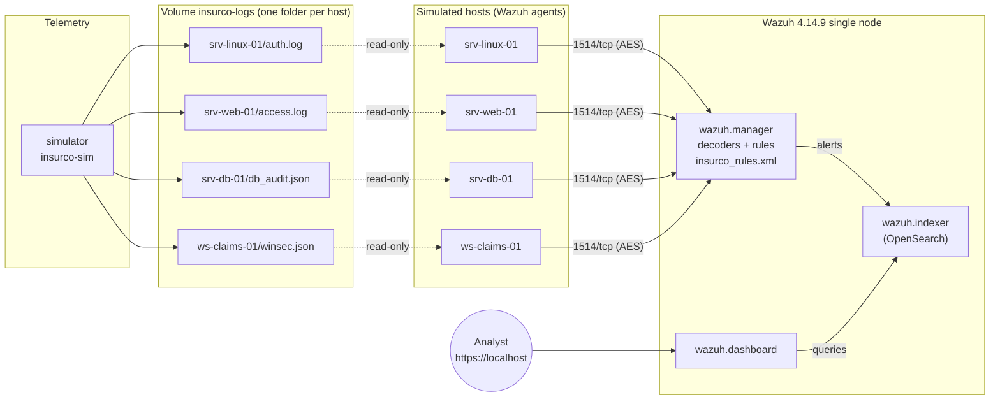

# Architecture

## Components

| Service | Image | Role |
|---|---|---|
| `wazuh.manager` | `wazuh/wazuh-manager:4.14.9` | Receives events, decodes, applies built-in + custom rules, writes alerts |
| `wazuh.indexer` | `wazuh/wazuh-indexer:4.14.9` | Stores alerts (`wazuh-alerts-*`) and archives |
| `wazuh.dashboard` | `wazuh/wazuh-dashboard:4.14.9` | Web UI on `https://localhost` |
| `simulator` | built from `simulator/` | Writes realistic background activity plus an attack scenario every 2-5 min |
| `srv-linux-01` | built from `agents/` | Linux server: sshd + sudo (syslog) |
| `srv-web-01` | built from `agents/` | Business web app: Apache access log |
| `srv-db-01` | built from `agents/` | Customer database: audit log (JSON) |
| `ws-claims-01` | built from `agents/` | Claims workstation: Windows security events (JSON) |

## Design decisions

- **One Docker network, DNS names.** Agents reach `wazuh.manager` directly; no
  proxy, no hard-coded IPs.
- **One folder per host, mounted read-only.** An event is collected by exactly
  one agent, the way it would be in production.
- **Configuration as code.** The agent config is rendered from
  `agents/ossec.conf.tpl` at start; the manager config and the custom rules are
  mounted from the repository. Rebuilding a container never loses a fix.
- **Pinned versions.** `WAZUH_VERSION` drives every image and the agent
  package, because Wazuh rejects agents newer than the manager.
- **Local only.** Every published port is bound to `127.0.0.1`.
- **No default password in use.** `scripts/rotate-passwords.sh` generates the
  secrets into git-ignored files that compose mounts in place of the committed
  upstream defaults ([SECURITY.md](../SECURITY.md)).
- **Start order by health, not by luck.** Each Wazuh service has a health check
  (manager: core daemons running; indexer: cluster health with the admin client
  certificate; dashboard: `/api/status` as `kibanaserver`). Agents wait for a
  healthy manager, the dashboard for a healthy indexer and manager, and `make up`
  waits for all of them.
- **Bounded storage.** An ISM policy deletes `wazuh-alerts-*` indices 30 days after
  creation (`stack/config/wazuh_indexer/ism/`, applied by `scripts/apply_ism.py`).
- **Simulated Windows events are JSON**, not real EVTX. That keeps the lab
  light and portable; real Windows telemetry (Sysmon) is a roadmap item.

## From lab to production

The lab maps one-to-one to a real deployment: replace each simulated host by a
real agent reading the real log file (`/var/log/auth.log`, Apache logs, the DBMS
audit trail, the Windows Security channel). See
[production-integration.md](production-integration.md).
