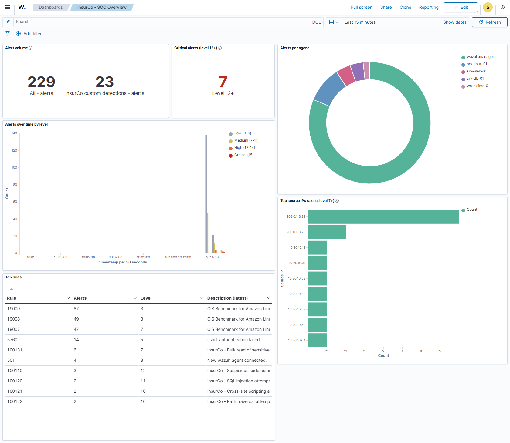
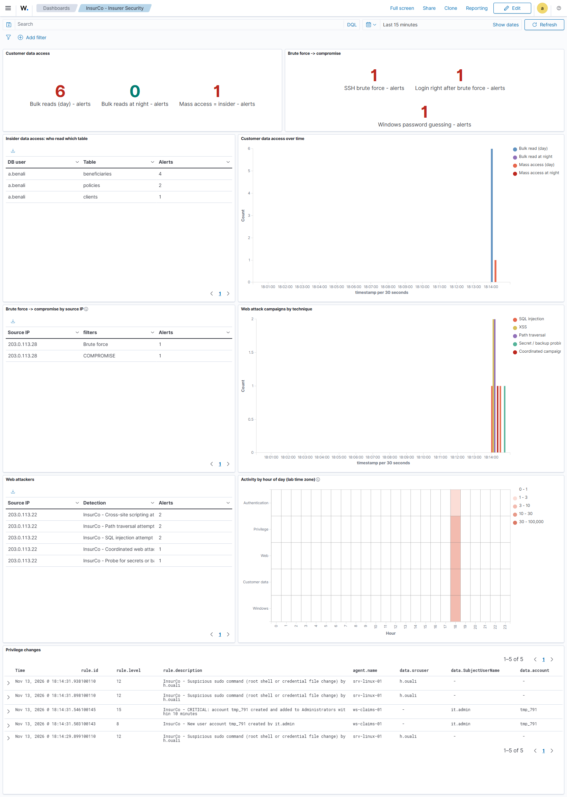

# SOC dashboards as code

Two OpenSearch Dashboards dashboards live in git as saved-object exports
(`dashboards/*.ndjson`) and are imported automatically after `make up` /
`lab.ps1 up`. After `make reset && make up` they show data with no manual click.

| Dashboard | For | Panels |
|---|---|---|
| **InsurCo - SOC Overview** | the first 30 seconds of a shift | alert volume (all / custom), critical count (level 12+), alerts over time by level, top rules, top source IPs (level 7+), alerts per agent |
| **InsurCo - Insurer Security** | threats specific to an insurer | customer-data access (who read which table, day vs night, mass access), brute force -> compromise (KPIs, per source IP), web attack campaigns by technique and attacker, privilege changes (saved search), activity heatmap by hour of day |





*Screenshots: a lab started from a clean state (`down -v`, `up`), the six scenarios injected
once, last hour. Taken by `scripts/screenshot_dashboards.py`.*

## How it works

```text
scripts/build_dashboards.py  --(saved-objects API: _bulk_create, then _export)-->  dashboards/*.ndjson
dashboards/*.ndjson          --(scripts/import_dashboards.py: _import?overwrite=true)-->  running lab
```

- **Defined in code, built through the API.** `scripts/build_dashboards.py` describes every
  panel (aggregations, KQL queries, colours, layout) in Python, creates the objects in the
  running dashboard with `POST /api/saved_objects/_bulk_create?overwrite=true`, then exports
  them with `POST /api/saved_objects/_export` (references included). The files are what
  OpenSearch Dashboards itself produces, normalised for clean diffs (sorted, no timestamps).
  Nobody clicks a panel together and exports it by hand.
- **Imported idempotently.** `scripts/import_dashboards.py` waits for the dashboard API, then
  posts each file to `_import?overwrite=true`. Every object has a fixed id (`insurco-...`), so
  a second run replaces the objects in place: still 2 dashboards, 14 visualizations, 1 saved
  search, 1 index pattern. Changes made in the UI are overwritten by the version in git.
- **Own index pattern.** The files carry an index pattern `insurco-alerts` (title
  `wazuh-alerts-*`, time field `timestamp`). The Wazuh app creates its own pattern only when
  someone opens it, which would break "no manual click". Only a scripted field is stored; the
  real field list is read from the live mapping when the dashboard opens.
- **Hour of day in the lab time zone.** The heatmap uses a painless scripted field
  (`hour_of_day`) that converts `timestamp` to `Africa/Algiers`. At import, `LAB_TZ` (environment
  or `.env`) replaces it when it is an IANA zone name; a POSIX TZ string (the e2e workflow pins
  the manager clock with one) is not understood by Java, so the default is kept.
- **TLS stays verified.** Both scripts talk to `127.0.0.1:443` and check the certificate
  against the lab CA for the name `wazuh.dashboard` (`scripts/indexer_client.py`), as the
  indexer scripts already do.

## Filters are proven by tests

Panels filter only with `rule.id:...` and `rule.groups:...` KQL terms.
`detection/tests/test_dashboards.py` (run in CI with the other static checks) reads every
query in the `.ndjson` files and fails when:

- a `rule.id` is not a custom rule, writes no alert (level below `log_alert_level` 3, e.g.
  100141), or has no positive case in `detection/tests/cases.yaml`;
- a `rule.groups` value belongs to no custom rule, or to none that is an alert proven by a test;
- a file references an object it does not contain, or no longer matches `build_dashboards.py`.

| Panel | Query / split |
|---|---|
| Alert volume | `*`, `rule.groups:insurco` |
| Critical alerts | `rule.level >= 12` (the threshold planned for phase 6 routing) |
| Alerts over time by level | bands 0-6, 7-11, 12-14, 15 on `rule.level` |
| Top source IPs | `rule.level >= 7`, terms on `data.srcip` (SSH, web, DB client; Windows events keep the address in `data.IpAddress`) |
| Customer data access | `rule.id`: 100131 / 100137 (day), 100133 / 100138 (night) - simulated DB audit / real pgaudit trail; 100132 / 100134 (mass access, both trails) |
| Insider: who read which table | `rule.groups:(insurco_bulk_read or insider_threat)`, by `data.db_user`, `data.table` |
| Brute force -> compromise | `rule.id`: 100100, 100101, 100142; by `data.srcip` for 100100 / 100101 |
| Web attack campaigns | `rule.groups:insurco_web` split by `sqli`, `xss`, `path_traversal`, `web_scan`, `coordinated_attack` |
| Privilege changes | `rule.id:(100110 or 100143 or 100144 or 100145)` |
| Activity by hour of day | `rule.groups:insurco`, families `insurco_auth`, `insurco_privesc`, `insurco_web`, `insurco_db`, `insurco_windows` |

## Commands

```bash
make up                                   # starts the lab and imports the dashboards
make dashboards                           # re-import only (lab.ps1 dashboards)
python scripts/build_dashboards.py        # after editing a panel: rebuild in the lab + re-export
python -m pytest -q detection/tests       # the filter check above

# README screenshots (needs: pip install playwright; playwright install chromium)
for s in brute_force insider web_campaign privesc rogue_admin password_spray; do
  docker compose exec simulator insurco-sim inject "$s"; done
python scripts/screenshot_dashboards.py --from now-1h        # add --channel msedge to use Edge
```

The screenshot script logs in through the security plugin's `/auth/login`, waits until every
panel reports `data-render-complete` and the charts stop changing for 3 s (the heatmap reports
"complete" before it draws), and writes `docs/img/<dashboard>.png`. The headless
browser skips certificate checks for `https://localhost` (the certificate is issued to
`wazuh.dashboard`); that is a shortcut for a lab-local tool only.

## Limits

- The dashboards open on the last 24 hours, refreshed every minute. Right after a reset the
  time series are a thin strip at the right edge; pick "Last 1 hour".
- The SOC Overview counts every alert, built-in ones included (sshd, sudo, CIS benchmark of the
  manager). Top rules is dominated by them by design: that is the real alert mix an analyst sees.
- Night-only rules (100102, 100103, 100133, 100134) appear only when the manager clock is
  between 22:00 and 06:00.
- CI imports the dashboards on every e2e run (`make up`), so a broken file fails there, but CI
  does not render them: the "panels show data" check is the screenshot run above.
