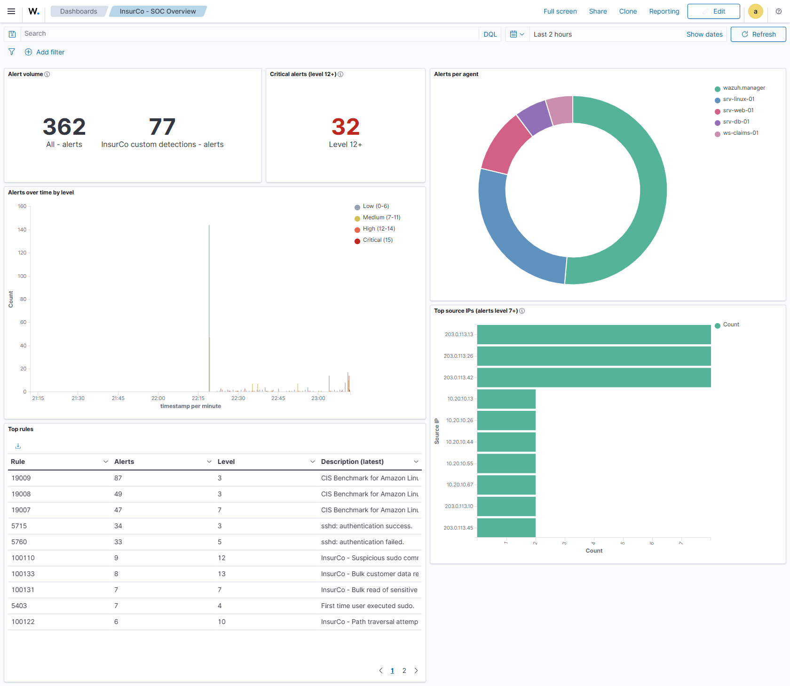

# insurance-soc-lab

**A complete SOC lab for an insurance company, in one command:** a Wazuh SIEM, monitored
hosts, a telemetry simulator that attacks the company every few minutes, and custom
detection rules that are each tested against the real Wazuh engine in CI - then routed,
answered and translated to Sigma.

The lab was first designed and deployed during a 2026 cybersecurity internship in the IT
security team of a **major Algerian insurance company**. This public version uses a fictional
insurer, **InsurCo**, and only synthetic data.

## Where to start

| You want to... | Read |
|---|---|
| Run it (about 10 minutes from a clone) | [Quick start in the README](https://github.com/arixstoo/insurance-soc-lab#quick-start) |
| See how it fits together | [Architecture](architecture.md) |
| Know what it detects, and what it misses | [Detection catalog](detection-catalog.md) - rules, tests, false positives, coverage gaps, Sigma, threat intel |
| Trust the alert volume | [Tuning report](tuning-report.md) - 24 h of normal activity replayed through the real engine |
| Handle an alert | [Runbooks](runbooks/README.md) and [alert routing / active response](response.md) |
| See real logs, not only simulated ones | [Real services](real-services.md) |
| Look at the dashboards | [Dashboards](dashboards.md) |
| Take it to a real network | [From lab to production](production-integration.md) |
| Learn from the mistakes | [Lessons learned](lessons-learned.md) |

ATT&CK coverage as a Navigator layer, generated from the rules:
[mitre-layer.json](mitre-layer.json) -
[open it in the ATT&CK Navigator](https://mitre-attack.github.io/attack-navigator/#layerURL=https%3A%2F%2Fraw.githubusercontent.com%2Farixstoo%2Finsurance-soc-lab%2Fmain%2Fdocs%2Fmitre-layer.json).

Source, issues and releases: [github.com/arixstoo/insurance-soc-lab](https://github.com/arixstoo/insurance-soc-lab).
