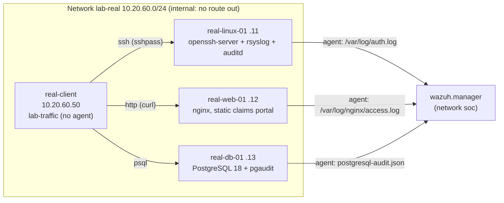

# Real services in the lab (compose profile `real`)

The default lab is **simulated**: `insurco-sim` writes log lines that look like sshd, Apache,
a database audit trail and Windows events, and four agents read them. Phase 4 adds, next to
it, hosts that run the **real software** - `sshd`, `nginx`, PostgreSQL with `pgaudit` - each
with a Wazuh agent reading the log file that software really writes. A test client sends
scripted traffic to them, so the detection rules are checked on genuine logs too.

```bash
make up REAL=1                     # or: docker compose --profile real up -d --build --wait
make traffic                       # or: docker compose --profile real exec real-client lab-traffic all
docker compose --profile real exec real-client lab-traffic list    # jobs and expected rules
python scripts/lab_status.py       # 7 agents when the profile runs
bash scripts/e2e.sh                # auto-detects the profile (E2E_REAL=1 / 0 to force)
```

PowerShell: `.\scripts\lab.ps1 up -Real`, `.\scripts\lab.ps1 traffic`. Without the profile
nothing changes: same 8 services, same 4 agents.

## What runs



| Service | Built from | Real software | Log read by its agent |
|---|---|---|---|
| `real-secrets` | `alpine:3.22`, one-shot | - | Generates per-lab passwords into the `real-secrets` volume |
| `real-linux-01` | `real/linux/` (FROM the lab agent image) | OpenSSH 10.2, rsyslog (Ubuntu defaults), auditd | `/var/log/auth.log` (syslog), `/var/log/audit/audit.log` (audit) |
| `real-web-01` | `real/web/` | nginx 1.28, static "claims portal" (`real/web/site/`) | `/var/log/nginx/access.log` (combined) |
| `real-db-01` | `real/db/` | PostgreSQL 18 + pgaudit 18, FAKE seed data | `/var/log/postgresql/postgresql-audit.json` (jsonlog) |
| `real-client` | `real/client/` | sshpass, curl, psql | - (not a monitored host) |

The three hosts are built `FROM` the lab agent image (`agents/Dockerfile`, passed by compose
as an additional build context), so the agent version is the manager's. Each host image
ships its own agent config template and start script; nothing is edited in a running
container.

## Scope and safety

This is a defensive test harness: its only job is to make real services write real log
lines that the rules must recognise.

- **Lab containers only.** `real-client` is only attached to `lab-real`, an `internal`
  Docker network with no gateway: it cannot reach the Internet or the host's LAN.
  `lab-traffic` also resolves each target and refuses to run if it is not in
  `10.20.60.0/24`. Its targets are hard-coded (`real-linux-01`, `real-web-01`, `real-db-01`).
- **No published port.** None of the real services is reachable from outside Docker.
- **Lab test accounts only.** SSH: `lab.tester` and `lab.ops`, no sudo, `PermitRootLogin no`,
  `AllowUsers` limited to them. PostgreSQL: `portal_app`, `svc_reporting`, `lab_analyst`,
  SELECT only (plus `UPDATE (status)` on `claims` for the portal), accepted from the test
  client's address only (`real/db/pg_hba.conf`).
- **No password in git or `.env`.** `real-secrets` writes random passwords into a volume that
  only the real hosts and the test client mount. Wrong passwords are the literal strings
  `wrong-password-1..6`. pgaudit redacts passwords in `ALTER ROLE` lines (`<REDACTED>`).
- **Fake data.** `real/db/gen_seed.py` generates the customers with Faker (seed 2026, pinned
  version, at image build time): `example.*` e-mail addresses, no phone, no national id, no
  bank account.
- **One relaxed default, scoped.** OpenSSH >= 9.8 penalises a source address after failed
  logins (`PerSourcePenalties`). It stays on for everyone except the test client
  (`PerSourcePenaltyExemptList 10.20.60.50`), which must log in right after its failures.

## The test traffic (`lab-traffic`)

| Job | What it does | Expected custom rules (day) |
|---|---|---|
| `ssh` | `lab.ops` logs in once; `lab.tester` fails 6 times (`sshpass`), then logs in | 100100 (6th failure), 100101 (the login) |
| `web` | The `real: true` cases of `detection/tests/cases.yaml`: benign requests once, malformed ones (SQLi, XSS, path traversal, `.env` probe) twice, with `curl --path-as-is --globoff` so they are sent exactly as written | 100120, 100121, 100122, 100123, 100129 (5th malformed request) |
| `db` | `portal_app` reads 3 clients and their claims, approves one claim; `svc_reporting` extracts the 5 sensitive tables (allow-listed); `lab_analyst` exports the 5 sensitive tables to CSV | 100137 (x4), 100132 (5th export) |

The web requests come from the test cases on purpose: a malformed request is tested twice,
once as a log line in `wazuh-logtest`, once sent to a real nginx and read back from its log.

## Same rules, simulated and real

| Family | Simulated host | Real host | Rules | Same rule ids? |
|---|---|---|---|---|
| SSH brute force -> compromise | `srv-linux-01` | `real-linux-01` | 100100, 100101 (+ 100102 / 100103 at night) | yes, unchanged |
| Web attacks | `srv-web-01` | `real-web-01` | 100120-100123, 100129 | yes, unchanged |
| Customer data access | `srv-db-01` | `real-db-01` | simulated 100130 -> 100131 / 100133; real 100135 -> 100136 -> 100137 / 100138; **shared** 100132 / 100134 | entry rules differ, correlations shared |

`scripts/e2e.sh` asserts each real job's rules **on the real host's agent**, then prints a
"same detection family" table and fails if a family fired on only one side. The CI workflow
`e2e.yml` runs it with the profile on. Measured run (Docker Desktop, 2026-11-12): see the
end of this page.

Why the database family needs its own entry rules: the obvious change,
`<if_sid>100130,100136</if_sid>` on 100131, made 100131 stop feeding the group correlation
100132 - even for simulated reads (verified with `wazuh-logtest`). So 100137 / 100138 repeat
the conditions of 100131 / 100133 and a unit test (`test_rule_coverage.py`) fails if they
drift apart. A second finding: a rule with only `<if_matched_group>` (100132) is attached to
the group's rules defined *before* it, so the real block sits above 100132 in the file.

## Simulated vs real logs: the differences

| | Simulated (`insurco-sim`) | Real |
|---|---|---|
| **SSH timestamps** | `Nov 12 10:00:00` (classic syslog) | `2026-11-12T10:00:00.123456+01:00` (RFC 3339, Ubuntu rsyslog default since 24.04); Wazuh's pre-decoder handles both |
| **SSH program name** | `sshd` | `sshd-session` (OpenSSH 10 splits the daemon); the sshd decoders match it |
| **Events per failed password** | 1 (`Failed password`) | 3-4: `unix_chkpwd` (5557), PAM `authentication failure` (5503), `Failed password` (5760), `Connection closed ... [preauth]`. Only 5760 feeds 100100, but 3x the built-in alerts |
| **SSH source address** | Internet ranges (RFC 5737) and office `10.20.10.x` | Always the test client `10.20.60.50`, inside `10.20.0.0/16`: the night rule 100102 (outside the office network) cannot be exercised by the real job |
| **Web log** | Apache common/combined lines | nginx `combined` (same layout, decoded by the same `web-accesslog` decoder); statuses are what nginx really answers (`200` for the portal's pages, `404` for `/.env`) - the built-in web rules key on the URL, not the status |
| **Database audit** | One JSON object per query: `db_user`, `table`, `rows_returned`, `source_ip` | PostgreSQL `jsonlog` + pgaudit CSV message: class (READ, WRITE, DDL, ROLE), command, `schema.table`, statement, rows. Decoder `insurco-pgaudit` maps it to the same field names |
| **One query, how many lines** | 1 | 1 per table touched (`log_relation`): a JOIN of `claims` and `policies` is 2 lines with the statement's row count each |
| **Writes** | Not simulated | Audited as WRITE (100135), never counted as bulk reads |
| **Noise you only get on real hosts** | - | Server start-up lines (built-in 1002 at level 2, on the `error_severity` key), the agent's own start events, and the seed load: every foreign-key check of the ~4000 inserted rows is an audited internal read (~3200 lines), so auditing is switched off for that one session (`SET pgaudit.log = 'none'`) |
| **Time zone** | The simulator writes local `LAB_TZ` time | The host images have no tzdata: with the default `LAB_TZ=Africa/Algiers` sshd and nginx log in UTC (RFC 3339 / nginx lines carry the offset, so nothing is ambiguous); PostgreSQL ships its own zone data and logs CET |
| **Volume** | Continuous background, office-hours profile | Only what the test client sends (on demand) |

## What the real logs revealed

- **`ignore` mutes a rule for everyone.** The first e2e run sent the real traffic right after
  the simulated scenarios: every correlation that had just fired on a simulated host
  (100100, 100101, 100129, 100132) stayed silent on the real host, while every single-event
  rule fired on both. Wazuh's `ignore` attribute suppresses the whole rule for N seconds
  after it fires, whatever the source address or user. `e2e.sh` now sends the real traffic
  first and waits longer than the largest `ignore` (300 s); the detection gap ("a second
  attacker inside the window is not correlated") is listed in the catalog.
- **Rule tree shape matters** (two parents, file order): see above.
- **`PerSourcePenalties`** would have hidden the brute-force-then-success pattern from the
  test (the successful login is refused); in production it is a control worth keeping.
- **Time rules in the running lab use UTC** (found while testing the real DB at 22:20 local):
  `wazuh-analysisd` runs chrooted in `/var/ossec`, where `TZ=Africa/Algiers` cannot be
  resolved (no zoneinfo), so `<time>` rules see UTC - one hour off for Algiers. The tests and
  the e2e workflow use POSIX TZ strings (`LAB-14`), which need no zoneinfo, so they were not
  affected. Not fixed in this phase (candidate: a POSIX default such as `CET-1`, Algeria has
  no daylight saving time).

## Limits (honest list)

- **auditd usually does not run.** The kernel only accepts an audit daemon from the initial
  PID namespace, one per kernel; Docker Desktop's WSL2 kernel refuses even `auditctl -s`.
  `real-linux-01` tries, prints a warning and carries on (SSH detection needs only
  `auth.log`). The rules (`real/linux/insurco.rules`) and the agent's `audit.log` input are in
  place for a VM. The lab does not use `pid: host` to force it.
- **Day-time only in CI.** The e2e workflow pins the manager to 12:00; the night variants
  (100102, 100103, 100138, 100134 on real lines) are covered by `clock: night` cases in
  `cases.yaml`, not by real traffic at night.
- **One test client address.** Every real event comes from `10.20.60.50`; the allow-listed
  scanner path (`scanner-ips`) is tested on log lines only.
- **Rebuilding one real host** while the manager runs: the new container re-enrolls under
  the same name and the manager refuses it until it considers the old agent disconnected
  (`agents_disconnection_time`, 10 min). `docker compose restart wazuh.manager` (or a clean
  `down -v`) avoids the wait.
- **No Windows.** Real Windows events (Sysmon on a VM) remain an optional roadmap item.

## From lab to production

The real hosts are the production pattern in miniature: the agent reads the file the
service writes, and the decoders/rules are the same files as in the lab. For PostgreSQL:
`shared_preload_libraries = 'pgaudit'`, `log_destination = 'jsonlog'`, `pgaudit.log_relation`
and `pgaudit.log_rows` on, `pgaudit.log_parameter` off (never log bound customer data), the
agent `localfile` on the `.json` log, and the BI service accounts in `db-service-accounts`.
See [production-integration.md](production-integration.md).

## Measured run

Docker Desktop (Windows 11, WSL2), 2026-11-12, from a clean state (`down -v`), same settings
as `e2e.yml` (`COMPOSE_PROFILES=real`, manager at 12:00, random attacks off): healthy in
57 s, 7 active agents, `bash scripts/e2e.sh` -> `OK: 22/22 expected rules indexed`.

```text
== same detection family on simulated and real logs ==
real    alerts  twin    simulated verdict
100100  1       100100  1         both
100101  1       100101  1         both
100120  1       100120  2         both
100121  2       100121  2         both
100122  2       100122  2         both
100123  2       100123  1         both
100129  1       100129  1         both
100137  4       100131  9         both
100132  1       100132  1         both
```

(Counts per kind differ by one because the request or read that completes a correlation
raises the correlation instead of its own rule: "one event, one alert".)
