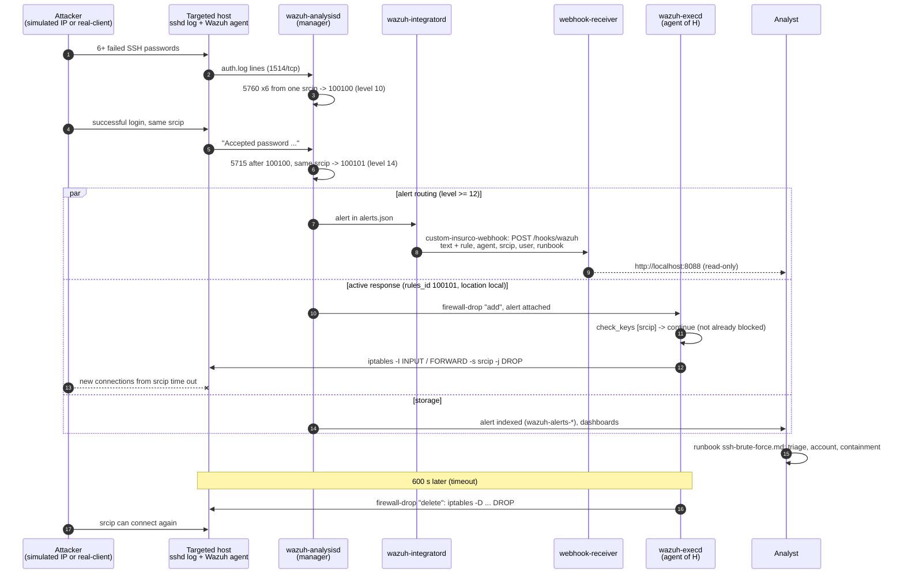

# Response: alert routing and active response (phase 6)

What happens after a rule fires, in the lab. Three pieces, all configuration as code:

| Piece | What | Where |
|---|---|---|
| Runbooks | one per alert family; each rule links its runbook (`<info type="link">`), so the link is in the alert, the catalog and the webhook message | [runbooks/](runbooks/README.md) |
| Alert routing | every alert of **level >= 12** is POSTed to a webhook by a Wazuh custom integration; the lab's `webhook-receiver` stores and shows them, offline | `response/integrations/`, `response/webhook-receiver/`, `<integration>` in `stack/config/wazuh_cluster/wazuh_manager.conf` |
| Active response | on **100101** (brute force followed by a successful login), the source IP is blocked **on the targeted host** for **10 minutes**, then unblocked automatically | `<active-response>` in the manager config, `cap_add: [NET_ADMIN]` on `srv-linux-01` and `real-linux-01` |

## The flow (brute force that succeeds)



## Alert routing

- **Script:** `response/integrations/custom-insurco-webhook.py`, run by
  `wazuh-integratord` through the sh wrapper of the same name, with the
  manager's bundled Python (3.10, standard library only). It reads the alert
  file, re-checks the level (>= 12, defence in depth), builds a message and POSTs
  it with a 5 s timeout and 3 attempts (network errors and 5xx are retried, a
  4xx is not). Failures go to `/var/ossec/logs/integrations.log`, never to an
  exception.
- **Message:** `{"username": "wazuh", "text": "[level 14] InsurCo - CRITICAL: ... (rule 100101, srv-linux-01) - runbook: https://...", "alert": {...}}`.
  The `text` field is what Slack, Mattermost and Rocket.Chat incoming webhooks
  expect, so the same script can point at a self-hosted chat channel: change
  `<hook_url>` (and set `<api_key>`, sent as `Authorization: Bearer`). The
  `alert` object holds id, timestamp, level, rule id, description, groups,
  MITRE ids, agent, source IP, user, runbook link, location and the first
  1000 characters of the log line.
- **Receiver:** `webhook-receiver` (Python standard library, non-root,
  `response/webhook-receiver/receiver.py`). Two listeners: **ingest** `:8080`
  (`POST /hooks/wazuh`, lab network only, not published) and a **read-only
  viewer** `:8081` published on `127.0.0.1:8088` (`/` HTML, `/api/messages`
  JSON, `?after=<seq>`). Messages are appended to a volume
  (`webhook-messages`, `messages.jsonl`) and survive restarts.
- **Untrusted text.** Alert fields carry attacker input (the web campaign's
  XSS payloads, user names). The viewer escapes everything, links only
  `http(s)` runbook URLs, and serves the page with
  `Content-Security-Policy: default-src 'none'` (no script at all).

Custom rules that reach the webhook today (level >= 12): 100101, 100110, 100129,
100132, 100133, 100134, 100138, 100144, 100145 (tested against
[runbooks/README.md](runbooks/README.md)). Built-in Wazuh rules of level 12+
are routed too: the real SSH traffic also raises the stock **40112**
("multiple authentication failures followed by a success", level 12), whose
message has no runbook link (its rule is not ours).

## Active response (lab only)

```xml
<active-response>
  <command>firewall-drop</command>   <!-- stock Wazuh script, timeout_allowed yes -->
  <location>local</location>         <!-- the agent whose log raised the alert -->
  <rules_id>100101</rules_id>
  <timeout>600</timeout>
</active-response>
```

- **Why 100101 only.** It is the one rule that says "a guess worked": a
  successful login from an IP that just failed 6 times. Blocking on 100100
  (failures only) would let anyone lock a partner or an office NAT out by
  typing wrong passwords. Blocking on web rules is the WAF's job.
- **Why on the targeted host, not everywhere.** `location local` keeps the
  blast radius to the server under attack. `all` would also change the
  firewall of hosts that never saw the attacker.
- **Lab-safe.** `firewall-drop` runs `iptables` inside the agent's container.
  Only `srv-linux-01` and `real-linux-01` get `NET_ADMIN`, which acts on the
  container's own network namespace: never `privileged`, never
  `network_mode: host`, the Docker host's firewall is not touched
  (`response/tests/test_response_config.py` enforces this). The manager
  white-lists `127.0.0.1`. A container restart clears the rules.
- **Simulated vs real.** On `srv-linux-01` the attacker is an RFC 5737
  address that exists only in the log: the rule is added and removed, nothing
  is really dropped. On `real-linux-01` (profile `real`) the attacker is the
  test client `10.20.60.50`, and its TCP connections to sshd really time out
  for 10 minutes. Consequence: **`lab-traffic ssh` (and `make traffic`) fails
  for 10 minutes after a run that raised 100101**; `lab-traffic` says so.
- **Expiry.** `wazuh-execd` on the agent keeps the timeout and runs
  `firewall-drop delete` when it ends; a second 100101 for an IP already
  blocked is answered `abort` by the `check_keys` exchange (no duplicate rule,
  no extension).

## Proving it

| Check | Command | What it proves |
|---|---|---|
| Unit (no Docker) | `python -m pytest -q response/tests` | message format, level filter, retries, receiver ingest / read-only / escaping / persistence, and that the config in git is the one described here |
| Live, simulated | `python scripts/check_response.py` | `inject brute_force` -> 100101 indexed -> webhook message with the runbook -> iptables DROP on srv-linux-01 -> removed after ~600 s |
| Live, real | `python scripts/check_response.py --target real` | same with `lab-traffic ssh` on real-linux-01, plus: sshd unreachable from the attacker while blocked, reachable after |
| CI | `e2e.yml`, after `e2e.sh` | `check_response.py --no-inject --target both`: the brute forces e2e already triggered must have produced all of the above |

By hand: `docker compose exec simulator insurco-sim inject brute_force`, open
<http://localhost:8088>, then
`docker compose exec srv-linux-01 iptables -S INPUT` and
`docker compose exec srv-linux-01 tail -f /var/ossec/logs/active-responses.log`.
To lift a block early: `docker compose exec srv-linux-01 iptables -D INPUT -s <ip>/32 -j DROP`
(and the same for `FORWARD`).

**Found while building it.** `check_response.py --target both` first sent the real
brute force ~15 s after the simulated one: 6 real failures, no 100100, no 100101.
Rule 100100 has `ignore="60"`, and Wazuh's `ignore` mutes the whole rule whatever
the source (already noted in the catalog's coverage gaps). The retry was then muted
again by one of the simulator's random brute forces. So: the script waits the
ignore window between targets, and a deterministic run disables random attacks
(`SIM_ATTACK_MIN=86400 SIM_ATTACK_MAX=86400 docker compose up -d simulator`), as
`e2e.yml` does. Seen from the defender's side it is a real gap: one attacker
brute-forcing every minute can hide a second one from 100100, and therefore from
the active response.

## From lab to production

- Point `<hook_url>` at the real channel over HTTPS and set `<api_key>`; keep
  the receiver's two-listener idea (who may post vs who may read).
- Active response: start in "alert only", then enable on one rule with a short
  timeout, add the monitoring, jump hosts and partner ranges to
  `<white_list>`, and prefer blocking at the perimeter firewall or the bastion
  (one place, logged) over every server's own `iptables`.
- An automatic block is containment, not remediation: the runbook still asks
  for the account to be disabled and the password rotated.
- Optional next step (roadmap): a SOAR workflow (Shuffle) that enriches the
  IP, opens a ticket and notifies, in place of the plain webhook.

## Measured run

`python scripts/check_response.py --target both` on a lab started from `down -v` with the
real profile (Docker Desktop, Windows 11, 2026-11-15, random attacks off):

| Step | srv-linux-01 (simulated) | real-linux-01 (real sshd) |
|---|---|---|
| Webhook message for 100101, with runbook link | ok (203.0.113.52) | ok (10.20.60.50) |
| Alert in `wazuh-alerts-*` | ok | ok |
| `-A INPUT -s <ip>/32 -j DROP` on the targeted host | ok | ok; TCP to `10.20.60.11:22` times out |
| Block held, then removed by execd | 601 s | 601 s; sshd reachable again |
